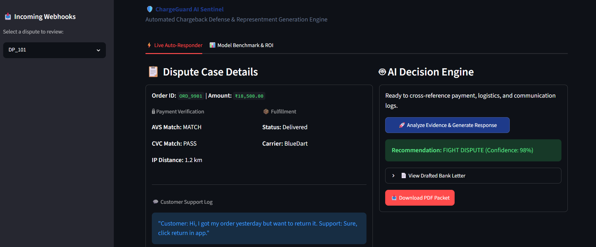
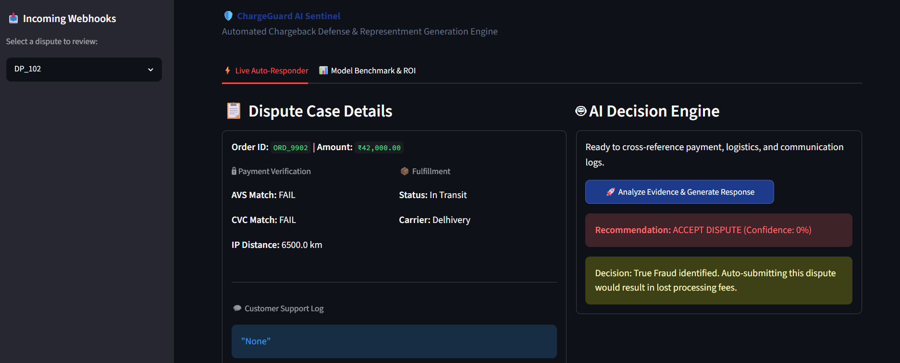
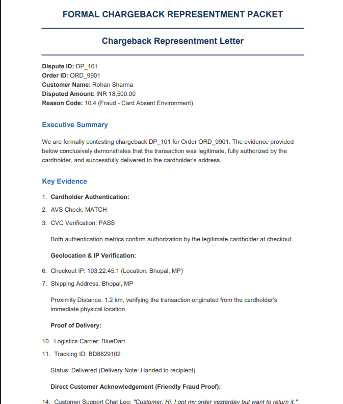
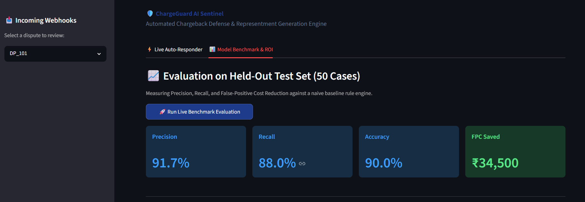
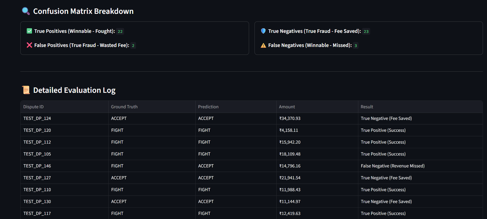

# 🛡️ ChargeGuard AI Sentinel

> An intelligent, defense-only chargeback auto-responder and evidence collector designed to prevent e-commerce merchants from losing revenue to friendly fraud and chargeback abuse.

---

## 📌 Problem & Context
Chargeback fraud and return abuse quietly destroy merchant margins. When a customer files a dispute ("Friendly Fraud"), merchants face a heavy burden of proof: manually gathering transaction logs, CVC/AVS checks, delivery proofs, and customer chat history across multiple platforms to submit a formal **Representment Packet**.

**ChargeGuard AI** solves this by:
1. **Automating Evidence Synthesis:** Retrieving cross-channel transaction details (Payment Gateway + Carrier + Chat Support).
2. **Deterministic Risk Evaluation:** Determining whether a dispute is *Fightable* or *Unwinnable True Fraud*.
3. **Preventing False-Positive Costs:** Suppressing unwinnable disputes to prevent merchants from paying non-refundable bank representment fees ($15–$25 per attempt).
4. **Generating Bank-Compliant PDFs:** Instantly outputting formal representment packages.

---

## 🚀 Features
* **AI Agent with Structured Output:** Powered by Google's `gemini-3.6-flash` and Pydantic schemas for zero-hallucination legal drafting.
* **Automated PDF Generator:** Converts structured LLM Markdown into formal PDF packets via `xhtml2pdf`.
* **Live Interactive Dashboard:** Streamlit UI allowing merchants to review incoming dispute webhooks in real time.
* **Held-Out Benchmark & ROI Suite:** Evaluates Precision, Recall, Confusion Matrix, and False-Positive Cost (FPC) on a 50-case test set.

---

## 🛠️ Tech Stack
* **Language:** Python 3.10+
* **Frontend Dashboard:** Streamlit
* **LLM & Reasoning Engine:** Google GenAI SDK (`gemini-3.6-flash`), Pydantic
* **PDF Engine:** `xhtml2pdf`, `markdown`
* **Data Management:** JSON / Python Data Pipelines

---

## 📸 Project Screenshots

### 1. AI Decision Engine & Automated Representment

### 2. Bank-Ready PDF Export

### 3. Held-Out Evaluation & ROI Metrics

